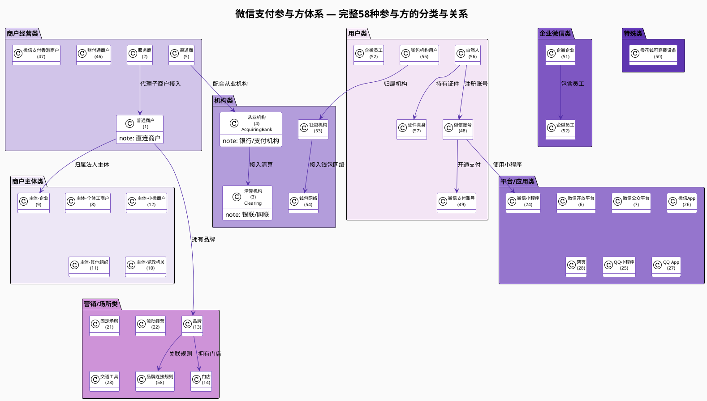
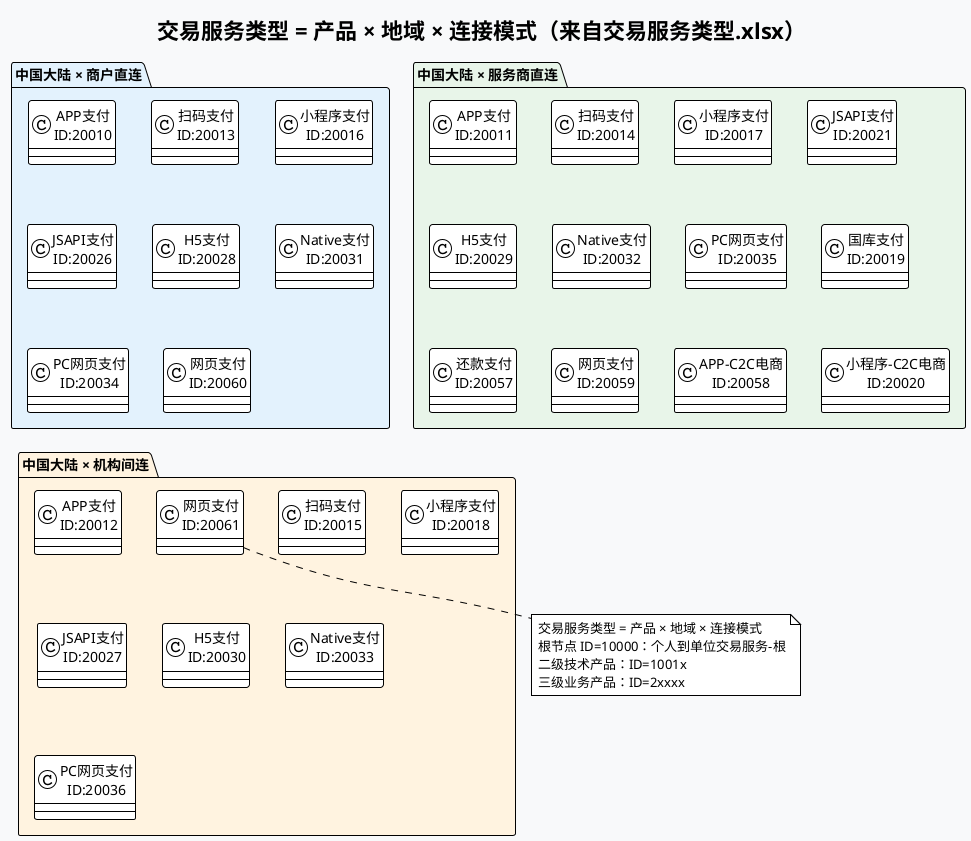
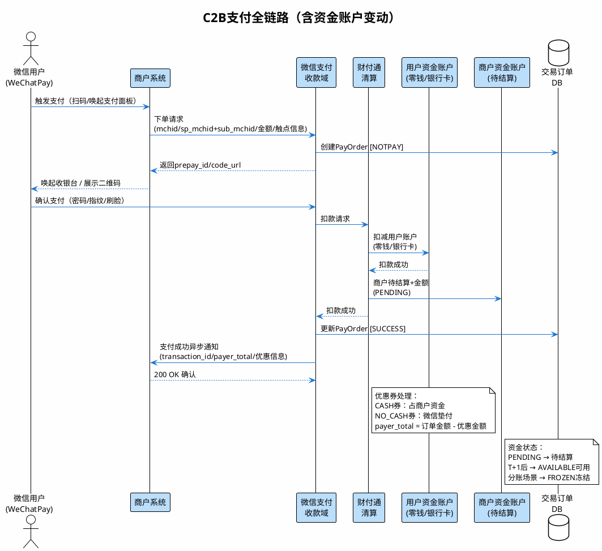
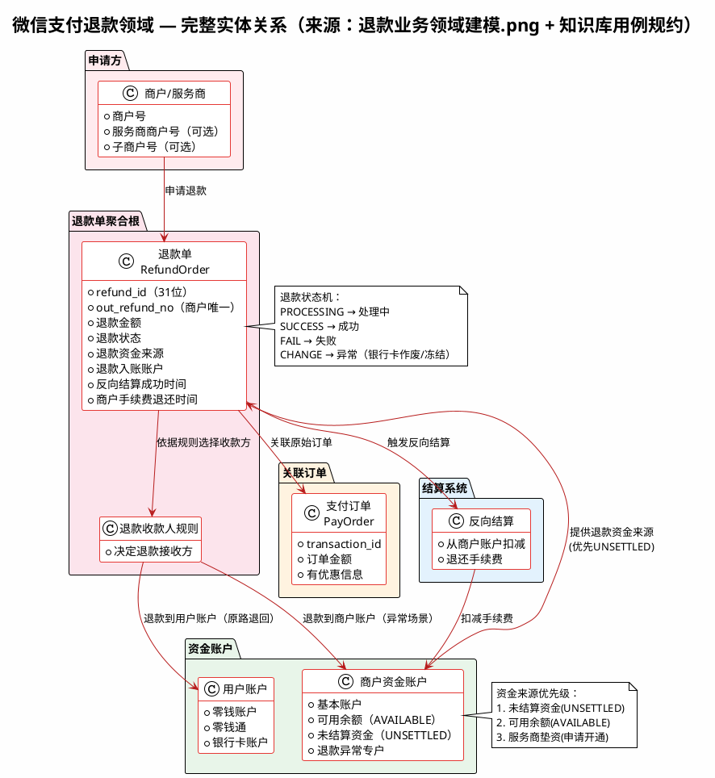
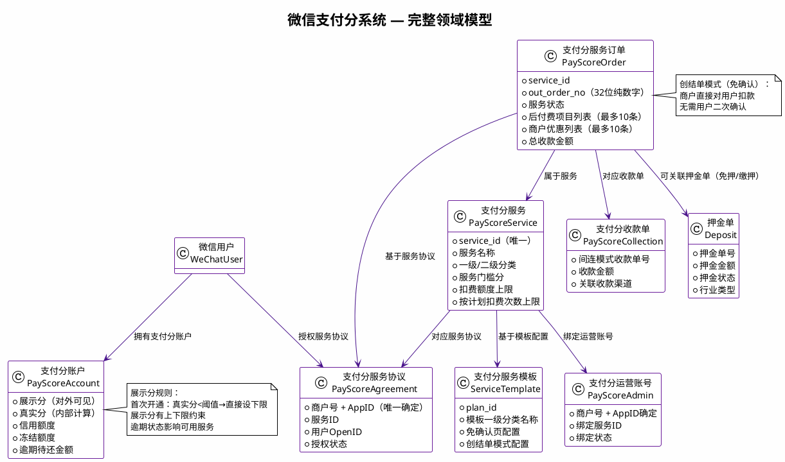
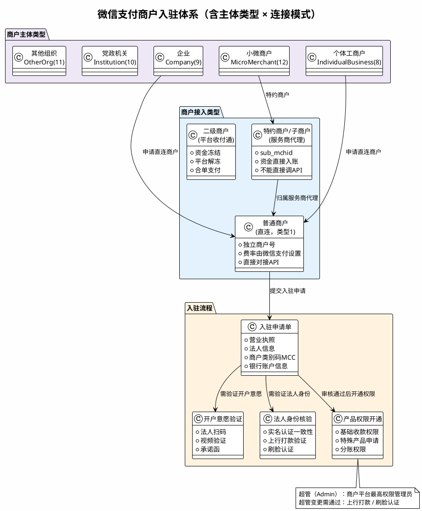
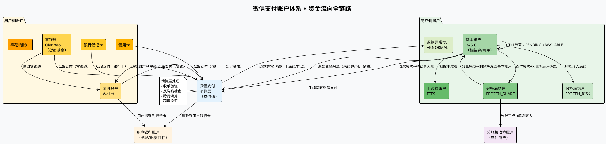

# 微信支付系统知识图谱 — 网状关系全景

> 基于工作区`业务知识/核心信息/`全部文件 + 业务知识/补充信息/微信支付名词列表0317.md
> + 业架业务知识库-test 知识库

---

## 一、知识图谱顶层架构

```plantuml
@startuml WxPay_Full_KG
!theme plain
skinparam backgroundColor #FAFAFA
skinparam package {
  BackgroundColor #E8F4FD
  BorderColor #1976D2
}
skinparam class {
  BackgroundColor #FFFFFF
  BorderColor #42A5F5
  ArrowColor #1565C0
  FontSize 11
}
skinparam note {
  BackgroundColor #FFF9C4
  BorderColor #F9A825
}
hide empty methods

title 微信支付系统知识图谱 — 全景本体

' =====================
' 参与方体系
' =====================
package "参与方体系" #EDE7F6 {
  class "自然人\nNaturalPerson" as NP #D1C4E9 {
    + 证件号+证件类型
    + 客户号（唯一）
  }
  class "证件真身\nCredentialsIdentity" as CI #D1C4E9 {
    + 财付通证件唯一标识
    + 证件类型
    + 证件号
  }
  class "微信账号\nWeChat" as WX #B39DDB {
    + openid
    + unionid
    + 微信号
  }
  class "微信支付账号\nWeChatPay" as WXPAY #9575CD {
    + uin（微信支付账号）
    + 实名等级：I/II/III类
    + 支付密码
  }
  class "普通商户\nMerchant" as MCH #B39DDB {
    + mchid（商户号）
    + 财付通商户号
    + 商户类别码(MCC)
    + 结算银行账户
  }
  class "服务商\nServiceProvider" as SP #9575CD {
    + sp_mchid（服务商商户号）
    + sp_appid
    + 受理产品权限
  }
  class "从业机构\nAcquiringBank" as BANK #7E57C2 {
    + 机构编码
  }
  class "清算机构\nClearing" as CLEAR #7E57C2 {
    + 清算机构商户号
    note: 银联/网联
  }
  class "品牌\nBrand" as BRAND #CE93D8 {
    + BrandId
    + BrandName
    + BrandLogo
    + BrandState
  }
  class "门店\nStore" as STORE #CE93D8 {
    + 门店外部ID
    + 门店地址
  }
  class "主体\nSubject" as SUBJ #D1C4E9 {
    + SubjectId
    + 主体类型
    + 营业执照
  }
}

' =====================
' 账户体系
' =====================
package "账户体系" #E8F5E9 {
  class "零钱账户\nWallet" as WALLET #A5D6A7 {
    + 可用余额
    + 冻结余额
    + 实名等级限额
  }
  class "零钱通\nQianbao" as LINGQT #81C784 {
    + 申购份额
    + 货币基金类型
    note: 1.0/1.5/2.0版本
  }
  class "银行卡(借记)\nDebitCard" as DC #A5D6A7 {
    + 卡号(PAN)
    + 银行预留手机号
    + 绑卡序列号
  }
  class "信用卡\nCreditCard" as CC #C8E6C9 {
    + 卡号(PAN)
    + 部分场景受限
  }
  class "商户资金账户\nMerchantFund" as MFA #66BB6A {
    + 基本账户(BASIC)
    + 手续费账户(FEES)
    + 经营账户(OPERATION)
    + 分账冻结户
    + 风控冻结户
    + 退款异常专户
  }
  class "支付分账户\nPayScoreAccount" as PSA #A5D6A7 {
    + 展示分
    + 真实分
    + 信用额度
  }
  class "零花钱账户\nPocketMoney" as PM #C8E6C9 {
    + 家长管控限额
    + 安全锁机制
  }
}

' =====================
' 交易体系
' =====================
package "交易体系" #FFF3E0 {
  class "支付订单\nPayOrder" as PO #FFE082 {
    + transaction_id
    + out_trade_no
    + trade_type(JSAPI/APP/NATIVE等)
    + 订单金额(分)
    + 支付成功时间
    + 订单状态
    + 资金流类型
    + 是否指定分账
  }
  class "退款单\nRefundOrder" as RO #FFCC80 {
    + refund_id
    + out_refund_no
    + 退款金额
    + 退款状态
    + 退款资金来源
    + 退款入账账户
  }
  class "结算单\nSettlementBill" as SB #FFE0B2 {
    + 计费费率
    + 结算金额
    + 应收/实收手续费
    + 结算入账账户类型
  }
  class "分账单\nProfitShare" as PS #FFAB91 {
    + 分账单号
    + 分账接收方列表
    + 分账比例/金额
    + 分账状态
  }
  class "委托扣款单\nDeductOrder" as DO #FFCC80 {
    + 合同号(contract_id)
    + 扣款金额
    + 扣款状态
  }
}

' =====================
' 协议体系
' =====================
package "协议体系" #FCE4EC {
  class "代扣协议\nDelegationContract" as DCON #F48FB1 {
    + contract_id
    + plan_id（模板ID）
    + 协议状态: SIGNED/TERMINATED
    + 签约时间
    + 有效期
  }
  class "支付分服务协议\nPayScoreAgreement" as PSC #F48FB1 {
    + 服务ID
    + 用户openid
    + 授权状态
  }
}

' =====================
' 产品/服务体系
' =====================
package "产品/服务体系" #E0F7FA {
  class "交易服务类型\nTxServiceType" as TST #80DEEA {
    + 服务ID（20xxx）
    + 产品类型
    + 地域（中国大陆/境外）
    + 连接模式（商户直连等）
  }
  class "产品权限\nProductPermission" as PP #80DEEA {
    + 商户号
    + 产品ID
    + 权限状态(已开通/申请中/未开通)
  }
  class "支付分服务\nPayScoreService" as PSV #4DD0E1 {
    + service_id
    + 服务名称
    + 服务门槛分
    + 扣费额度上限
  }
  class "支付分服务订单\nPayScoreOrder" as PSORD #4DD0E1 {
    + service_id
    + out_order_no（32位纯数字）
    + 服务状态
    + 后付费项目列表
  }
}

' =====================
' 营销体系
' =====================
package "营销体系" #F3E5F5 {
  class "代金券\nCoupon" as CPN #CE93D8 {
    + coupon_id
    + 券类型: CASH充值/NO_CASH非充值
    + 面额
    + 使用条件金额
    + 优惠标记(goodstag)
    + 券状态
  }
  class "商家券\nMerchantCoupon" as MCPN #CE93D8 {
    + card_id（批次号）
    + 券类型: NORMAL/DISCOUNT/EXCHANGE
  }
  class "企业红包\nEnterpriseRedPacket" as ERP #CE93D8 {
    + 红包金额
    + 发放类型
  }
  class "优惠活动\nPromotion" as PROMO #E1BEE7 {
    + 优惠ID
    + 活动类型
    + 投放计划
  }
}

' =====================
' 连接模式体系（关键）
' =====================
package "连接模式体系" #F1F8E9 {
  class "商户直连\nDirectConnect" as DCONN #AED581 {
    note: 商户直接对接微信支付\nmchid即收款账户
  }
  class "服务商直连\nSPConnect" as SPCONN #AED581 {
    note: sp_mchid + sub_mchid\n资金入子商户账户
  }
  class "机构直连\nInstDirect" as IDCONN #8BC34A {
    note: 从业机构直连清算
  }
  class "机构间连\nInstInter" as IICONN #8BC34A {
    note: 经银联/网联中转
  }
}

' =====================
' 核心关系网络
' =====================

' 用户体系
NP "1" --> "1..*" CI : 持有证件
NP --> WX : 注册
WX --> WXPAY : 开通支付
WXPAY --> WALLET : 拥有零钱账户
WXPAY --> DC : 绑定银行卡
WXPAY --> CC : 绑定信用卡
WXPAY --> PSA : 拥有支付分账户
WXPAY --> PM : 开通零花钱
WALLET --> LINGQT : 转入

' 商户体系
MCH --> SUBJ : 归属主体
MCH --> MFA : 拥有资金账户
MCH --> BRAND : 拥有品牌
BRAND --> STORE : 下设门店
SP "1" --> "0..*" MCH : 代理子商户

' 支付流程
WXPAY "0..*" --> "0..*" PO : 发起支付
MCH "1" --> "0..*" PO : 收款
PO --> TST : 使用交易服务类型
PO "1" --> "0..*" RO : 触发退款
PO "1" --> "0..1" SB : 触发结算
PO "1" --> "0..1" PS : 发起分账
PO "0..*" --> "0..*" CPN : 使用代金券

' 账户流水
SB --> MFA : 结算入账
RO --> WALLET : 退款入用户账户
RO --> MFA : 或退款入商户账户

' 代扣协议链路
WXPAY "0..*" --> "0..*" DCON : 签署代扣协议
DO "0..*" --> "1" DCON : 基于协议扣款
DO --> PO : 产生支付订单

' 支付分链路
WXPAY --> PSC : 授权支付分服务
MCH --> PSV : 注册支付分服务
PSORD "0..*" --> "1" PSC : 基于服务协议
PSORD "0..*" --> "1" PSV : 属于服务
PSORD --> PO : 后付款触发支付

' 产品权限
MCH --> PP : 开通产品权限
PP --> TST : 对应交易服务类型
TST --> DCONN : 商户直连模式
TST --> SPCONN : 服务商直连模式
TST --> IDCONN : 机构直连模式
TST --> IICONN : 机构间连模式

' 营销
MCH --> CPN : 发放代金券
MCH --> MCPN : 发放商家券
MCH --> ERP : 发放红包
MCH --> PROMO : 创建优惠活动
PROMO --> CPN : 包含代金券

@enduml
```



---

## 二、参与方体系详细关系图



---

## 三、连接模式×产品×地域 三维关系图



---

## 四、C2B支付流程 — 完整资金链路



---

## 五、退款领域完整关系图



---

## 六、支付分系统完整关系图



---

## 七、商户入驻与主体体系



---

## 八、账户体系与资金流向全景



---

## 九、微信支付系统全子域图（来自知识库文档路径结构）

以下是从业架业务知识库提取的**确定性正确的子域结构**：

```plantuml
@startuml WxPay_SubDomain
!theme plain
skinparam backgroundColor #F8F9FA
skinparam package {
  BackgroundColor #E8F4FD
  BorderColor #1976D2
}

title 微信支付系统子域全景图（来源：业架业务知识库-test）

package "微信支付系统" as WXPAY_SYS #EDE7F6 {
  package "C2B交易" {
    [付款码支付]
    [扫码支付]
    [JSAPI支付]
    [小程序支付]
    [APP支付]
    [H5支付]
    [PC网页支付]
    [刷脸支付]
  }
  package "商业退款" {
    [境内退款]
    [境外退款]
  }
  package "结算" {
    [收款结算]
    [商业收款结算]
  }
  package "分账" {
    [分账]
  }
  package "商户入驻" {
    [境内商户]
    [跨境商户]
  }
  package "商户基础" {
    [产品权限]
    [商户基础信息]
  }
  package "商户运营管理" {
    [产品权限运营]
    [商户风险管理]
  }
  package "用户信息" {
    [用户信息]
  }
  package "实名" {
    [实名认证]
  }
  package "用户支付方式" {
    [支付方式管理]
    [支付方式运营]
  }
  package "参与方运营" {
    [参与方定义]
    [参与方运营]
    [商户运营]
  }
  package "参与方关系运营" {
    [参与方关系定义]
    [参与方关系运营]
  }
  package "地域连接模式运营" {
    [地域连接模式定义]
  }
  package "境外" {
    [跨境支付]
    [资源活动立项管理]
  }
  package "客服服务" {
    [帮助中心]
    [商户服务]
  }
  package "业管运营工具" {
    [产品权限审批]
  }
}

package "微信支付分系统" as WXPAYSCORE #F3E5F5 {
  [支付分账户管理]
  [支付分服务授权]
  [支付分订单]
}

package "微信群收款系统" as WXGROUP #FFF3E0 {
  [群收款]
}

package "微信用户订单系统" as WXORDER #E8F5E9 {
  [购物订单]
}

package "在线业务研发支撑系统" as DEVOPS #E3F2FD {
  [契约管理]
  [系统需求]
  [系统数据权限管理]
}

@enduml
```
