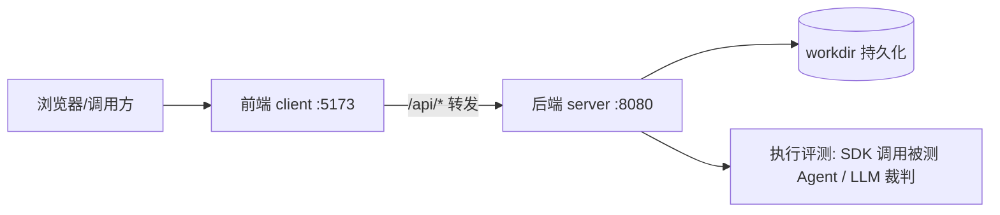

# 01 架构与部署

## 组件

| 组件 | 包名 | 命令 | 默认端口 | 职责 |
|------|------|------|----------|------|
| 后端 | `trpc-agent-eval-server`（pip，Python 3.10+） | `trpc-agent-eval-server` | 8080 | REST API（`/api/*`）、存储、执行评测；**无网页** |
| 前端 | `@tencent/trpc-agent-eval-client`（npm，Node 20+） | `trpc-agent-eval-client` | 5173 | Web UI，把 `/api/*` 转发到后端 |
| Worker（可选） | `trpc-agent-eval-worker`（pip，Python 3.10+） | `python3 -m trpc_agent_eval_worker.cli connect` | — | 执行**托管 Agent**（ClaudeCode/Codex/Hermes），可与后端异机部署 |

后端依赖 SDK `trpc-agent-self-evolution[all]>=0.1.12`，会随 pip 自动安装。

### SDK Agent（mode=sdk）

SDK 接入用于把业务侧 Python SDK Agent 直接加载进 WebUI 评测。它在**后端进程所在机器**读取用户项目目录并 import 指定模块，因此后端必须能访问该项目路径及其依赖环境。适合 server 和被测 Agent 同机的场景；不需要 worker，也不需要把 Agent 再包装成 HTTP 服务或 CLI。

### Worker（仅 managed 模式需要）

托管 Agent（[02](02-agents.md) 的 `mode=managed`）不在后端进程内执行，而是由 worker 领取任务后用本机
provider runtime（`claude`/`codex`/`hermes` CLI）执行。部署要点：

- 后端与 worker **必须配置同一个** `TRPC_AGENT_EVAL_WORKER_TOKEN`（后端未配置时 `/api/workers/*` fail-closed 返回 503）。
- 启动 worker：`TRPC_AGENT_EVAL_WORKER_TOKEN=<token> python3 -m trpc_agent_eval_worker.cli connect --server-url <backend>`。
  worker 自动发现本机已安装的 provider CLI 并注册为 runtime（可用 `TRPC_AGENT_EVAL_{CLAUDECODE,CODEX,HERMES}_PATH` 指定路径）。
- 查看在线 runtime：`GET /api/runtimes` 或 `discover.py`；建 managed Agent 时从中选 `runtime_id`。

## 数据流



- 直接访问后端端口只能调 API，看不到界面；要用 UI 必须通过前端地址。
- 仅做 API 集成（用本 skill 脚本）时可不装前端。

## 安装（腾讯镜像，发布包）

后端：
```bash
pip install trpc-agent-eval-server \
  --index-url https://mirrors.cloud.tencent.com/pypi/simple/ \
  --extra-index-url https://mirrors.tencent.com/repository/pypi/tencent_pypi/simple/
```
前端：
```bash
npm install -g @tencent/trpc-agent-eval-client --registry=https://mirrors.tencent.com/npm/
```
推荐直接用脚本：`bash scripts/install.sh`（已装则跳过，`--upgrade` 升级）。

## 启动

```bash
trpc-agent-eval-server --port 8080                          # 本机
trpc-agent-eval-server --host 0.0.0.0 --port 8080           # 分机对外
trpc-agent-eval-client --backend http://127.0.0.1:8080 --open
```
推荐用脚本：`bash scripts/serve.sh`（先探活复用、后台启动、日志落 workdir/logs）。

业务需要远程访问 WebUI 时，前端也要监听 `0.0.0.0`。Agent 应主动提供这个前端地址，不要等业务询问：

```bash
BACKEND_HOST=0.0.0.0 FRONTEND_HOST=0.0.0.0 bash scripts/serve.sh
# 如果自动探测的地址不可访问，再显式指定：
PUBLIC_HOST=<业务可访问IP或域名> BACKEND_HOST=0.0.0.0 FRONTEND_HOST=0.0.0.0 bash scripts/serve.sh
```

`PUBLIC_HOST` 只用于打印给用户的访问地址；不填时脚本会尝试自动探测本机 IP。前端进程连接后端时优先使用本机可连的探活地址。
脚本还会写入 `<workdir>/ui_urls.json`，记录 `frontend_url`、`backend_url`、`probe_backend_url` 和日志目录。Agent 后续创建对象时应读取这个文件，并持续把同一个 `frontend_url` 提供给业务查看。

### 后端配置项

| 配置 | 命令行 | 环境变量 | 默认 |
|------|--------|----------|------|
| 监听地址 | `--host` | — | `127.0.0.1` |
| 端口 | `--port` | — | `8080` |
| 数据目录 | `--workdir` | `TRPC_AGENT_EVAL_WORKDIR` | `~/.trpc-agent-eval` |
| 日志文件 | `--log-file` | `TRPC_AGENT_EVAL_LOG_FILE` | 无 |
| 日志级别 | `--log-level` | `TRPC_AGENT_EVAL_LOG_LEVEL` | `info` |
| 密钥主密钥 | — | `TRPC_EVAL_UI_SECRET` | 开发默认（生产必设） |
| Worker 鉴权 token | — | `TRPC_AGENT_EVAL_WORKER_TOKEN` | 无（用 managed 模式时必设，与 worker 一致） |

### 前端配置项

| 配置 | 命令行 | 环境变量 | 默认 |
|------|--------|----------|------|
| 后端地址 | `--backend`/`--api` | `TRPC_AGENT_EVAL_BACKEND_URL`（或 `_API_URL`） | `http://127.0.0.1:8080` |
| 监听地址 | `--host` | `TRPC_AGENT_EVAL_CLIENT_HOST` | `127.0.0.1` |
| 端口 | `--port` | `TRPC_AGENT_EVAL_CLIENT_PORT` | `5173` |
| 自动开浏览器 | `--open` | — | 关 |

## workdir（所有持久化数据）

```
<workdir>/
├── meta.db                 # 索引：Agent/数据集/方案/评测记录
├── secrets.enc             # 加密命名密钥（与 TRPC_EVAL_UI_SECRET 绑定）
├── env_vars.enc            # 加密环境变量
├── shared/models/index.json# 模型配置（含加密 api_key）
└── evaluation/
    ├── datasets/           # *.evalset.json
    ├── metrics/            # *.metric.json
    ├── results/runs/       # *.result.json / *.error.txt
    ├── behavior_checks/    # 行为检查脚本
    └── agent_tools/        # 自定义工具脚本
```

- 备份/迁移：停服后**整体复制 workdir**，并在新机器使用**相同 `TRPC_EVAL_UI_SECRET`**，否则无法解密密钥与模型 key。
- 上传单文件上限 16MB；脚本单文件 ≤64KB。
- 当前 workdir：`GET /api/workspace`。

## 运行时探查入口（操作前先查阅）

- 健康：`GET /api/health` → `{"status":"ok"}`
- 路由全景：`GET /openapi.json`（FastAPI 自带，亦可浏览 `/docs`）
- 指标 catalog：`GET /api/metric-configs/catalog`
- 模式可用指标：`GET /api/metric-configs/allowed?mode=cli&output_protocol=claudecode`
- 聚合查询：`python3 scripts/discover.py`
